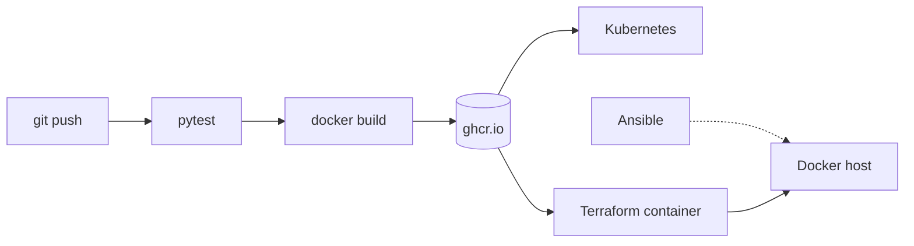

# devops-portfolio


A small Flask service taken through the whole delivery path: tests, container image, registry, Kubernetes, and infrastructure defined as code.

## Flow



## Layout

| Path | What it does |
|---|---|
| `app/` | Flask service with `/` and `/health`, tests, Dockerfile |
| `.github/workflows/` | Runs tests, then builds and pushes the image to ghcr.io |
| `k8s/` | Deployment, Service and Ingress for minikube |
| `terraform/` | Runs the published image as a container |
| `ansible/` | Prepares the host: base packages, Docker service, group access |

## Run it

Locally with Docker:

```bash
docker build -t devops-portfolio app/
docker run --rm -p 8000:8000 devops-portfolio
curl localhost:8000/health
```

On Kubernetes:

```bash
minikube start
minikube addons enable ingress
kubectl apply -f k8s/
curl http://$(minikube ip)/
```

With Terraform:

```bash
cd terraform
terraform init
terraform apply
curl localhost:8001/
```

Host setup with Ansible:

```bash
cd ansible
ansible-playbook -i inventory.ini playbook.yml --ask-become-pass
```

## Notes

- Every image is tagged with the commit SHA as well as `latest`, so a running version can be traced to a commit.
- The pod has readiness and liveness probes on `/health`, plus resource requests and a memory limit.
- The Service is ClusterIP only. Outside access goes through the Ingress.
- Terraform state is not committed. The provider lock file is.
